<div align="center">



# CarryOS

**Bilgisayarın, cebinde. · Your computer, in your pocket.**

Bir USB belleğe sığan, şifreli ev dizinli, Debian 13 tabanlı taşınabilir Linux.<br>
A portable, encrypted Linux based on Debian 13 that fits on a USB stick.

[**🌐 Web sitesi / Website**](https://carryos.github.io) ·
[**⬇️ İndir / Download**](https://github.com/carryos/carryos.github.io/releases/latest) ·
[**📝 Sürüm notları / Releases**](https://github.com/carryos/carryos.github.io/releases) ·
[**🐞 Sorun bildir / Report an issue**](https://github.com/carryos/carryos.github.io/issues)


</div>

---

🇹🇷 [Türkçe](#-türkçe) · 🇬🇧 [English](#-english)

---

## 🇹🇷 Türkçe

### CarryOS nedir?

CarryOS, bir USB belleğe sığan taşınabilir bir Linux dağıtımıdır. Şifreli ev dizinin, masaüstün ve programların seninle gelir; hangi bilgisayarda açarsan orası senin bilgisayarın olur. Ana bilgisayarın diskini kullanmaz.

> ⚠️ **Önizleme sürümü.** CarryOS henüz erken aşamada. Kendi makinende denemeden her donanımda çalışacağını garanti edemeyiz.

### Özellikler

| | |
|---|---|
| 🔐 **Şifreli ev dizini** | Dosyaların USB'de LUKS2 (argon2id) ile şifrelenir. Şifren olmadan bellek anlamsız bir veri yığınıdır. |
| 🧙 **Tek şifre, tek sihirbaz** | İlk açılışta kullanıcı adını ve şifreni seçersin. Aynı şifre hem hesabın olur hem şifreli depolamanı korur. |
| 🐧 **Debian 13 tabanı** | Köklü ve kararlı bir temel. Binlerce paket `apt` ile bir komut uzağında. |
| 🖥️ **MATE masaüstü** | Klasik düzeni ve düşük kaynak kullanımıyla bilinen, tanıdık bir masaüstü. |
| 🎒 **Seninle taşınır** | Ayarların, belgelerin ve kurduğun programlar USB'de kalır. |
| ⚙️ **UEFI ve eski BIOS** | GPT ile UEFI'li bilgisayarlar desteklenir. Eski BIOS desteği deneysel. |
| 🌐 **Hafif tarayıcı** | NetSurf ile kutudan çıkar çıkmaz web. Daha kapsamlısı için `apt` ile kur. |

### Kurulum

1. **İmajı indir:** [Sürümler](https://github.com/carryos/carryos.github.io/releases/latest) sayfasından `carryos.img` dosyasını indir ve SHA-256 toplamını doğrula.
2. **USB'ye yaz:** En az 16 GB bir bellek kullan (USB 3.0 önerilir). balenaEtcher, Rufus (DD modu) ya da `dd` ile yazabilirsin.
3. **USB'den başlat:** Bilgisayarı açarken boot menüsünü aç (F12, F10, Esc; Mac'te Option) ve belleği seç.
4. **Sihirbazı tamamla:** Kullanıcı adı ve şifreni seç. Şifreli depolaman hazırlanır, giriş ekranı gelir.

Linux / macOS'ta komut satırıyla:

```bash
# toplamı doğrula
sha256sum -c carryos.img.sha256

# belleğe yaz (sdX yerine kendi aygıtını yaz)
sudo dd if=carryos.img of=/dev/sdX bs=4M status=progress conv=fsync
```

> 🛑 `/dev/sdX` yerine **kendi USB aygıtını** yaz (`lsblk` ile bak). `dd`, hedef aygıtın tamamını siler.

### Uyumluluk

| | Durum |
|---|---|
| Mimari | x86-64 (64 bit) |
| UEFI (GPT) | ✅ Destekli |
| BIOS (MBR) | 🧪 Deneysel |
| Secure Boot | 🚧 Hazırlanıyor (shim · imzalı GRUB) |
| Ağ | ✅ NetworkManager, Wi-Fi ve kablolu |
| Bellek | En az 16 GB, USB 3.0 önerilir |

### Sıkça sorulanlar

<details>
<summary><b>Bilgisayarımın diskine zarar verir mi?</b></summary>

CarryOS USB'den açılır ve sistemi USB'ye kurar; ana diski kullanmaz. Yine de belleğe yazarken doğru aygıtı seç: yazma işlemi hedef aygıtın tamamını siler.
</details>

<details>
<summary><b>Şifremi unutursam ne olur?</b></summary>

Şifreli ev dizini şifre olmadan açılamaz; şifrelemenin amacı bu. Önemli dosyalarını ayrıca yedekle.
</details>

<details>
<summary><b>Programları nasıl güncellerim ya da kurarım?</b></summary>

Debian tabanlı olduğu için terminalde `sudo apt update && sudo apt upgrade` yeterli. Yeni programlar için `sudo apt install <paket>`.
</details>

### Sorun bildirme ve katkı

Bir hata mı buldun ya da önerin mi var? [Issues](https://github.com/carryos/carryos.github.io/issues) sayfasından bildirebilirsin. Hangi bilgisayar modelinde denediğini ve ne olduğunu yazman çok yardımcı olur.

---

## 🇬🇧 English

### What is CarryOS?

CarryOS is a portable Linux distribution that fits on a USB stick. Your encrypted home directory, your desktop and your programs travel with you: plug it into any computer and it becomes *your* computer. It does not use the host machine's disk.

> ⚠️ **Preview release.** CarryOS is in an early stage. We can't guarantee it works on every piece of hardware until you try it on yours.

### Features

| | |
|---|---|
| 🔐 **Encrypted home** | Your files are encrypted on the USB with LUKS2 (argon2id). Without your password the stick is just meaningless data. |
| 🧙 **One password, one wizard** | On first boot you pick a username and password. The same password becomes your account login and protects your encrypted storage. |
| 🐧 **Debian 13 base** | A rock-solid foundation. Thousands of packages are one `apt` command away. |
| 🖥️ **MATE desktop** | A familiar desktop known for its classic layout and low resource use. |
| 🎒 **Goes with you** | Your settings, documents and installed programs stay on the USB. |
| ⚙️ **UEFI and legacy BIOS** | UEFI computers with GPT are supported. Legacy BIOS support is experimental. |
| 🌐 **Light browser** | Web out of the box with NetSurf. Want a fuller browser? Install it with `apt`. |

### Installation

1. **Download the image:** get `carryos.img` from the [Releases](https://github.com/carryos/carryos.github.io/releases/latest) page and verify its SHA-256 checksum.
2. **Write it to a USB stick:** use at least 16 GB (USB 3.0 recommended). balenaEtcher, Rufus (DD mode) or `dd` all work.
3. **Boot from USB:** open the boot menu when powering on (F12, F10, Esc; Option on a Mac) and pick the stick.
4. **Finish the wizard:** choose a username and password. Your encrypted storage is set up and the login screen appears.

On Linux / macOS from the command line:

```bash
# verify the checksum
sha256sum -c carryos.img.sha256

# write to the stick (replace sdX with your own device)
sudo dd if=carryos.img of=/dev/sdX bs=4M status=progress conv=fsync
```

> 🛑 Replace `/dev/sdX` with **your own USB device** (check with `lsblk`). `dd` erases the entire target device.

### Compatibility

| | Status |
|---|---|
| Architecture | x86-64 (64-bit) |
| UEFI (GPT) | ✅ Supported |
| BIOS (MBR) | 🧪 Experimental |
| Secure Boot | 🚧 In progress (shim · signed GRUB) |
| Network | ✅ NetworkManager, Wi-Fi and wired |
| Storage | At least 16 GB, USB 3.0 recommended |

### FAQ

<details>
<summary><b>Will it harm my computer's disk?</b></summary>

CarryOS boots from USB and installs onto the USB; it doesn't touch the main disk. Still, pick the right device when writing the image: writing erases the whole target device.
</details>

<details>
<summary><b>What if I forget my password?</b></summary>

The encrypted home can't be opened without the password; that's the point of encryption. Keep separate backups of important files.
</details>

<details>
<summary><b>How do I update or install software?</b></summary>

It's Debian-based, so `sudo apt update && sudo apt upgrade` is enough. Install new programs with `sudo apt install <package>`.
</details>

### Reporting issues & contributing

Found a bug or have a suggestion? Open an [issue](https://github.com/carryos/carryos.github.io/issues). Please include which computer model you tried it on and what happened.

---

## 🌐 Web sitesi / The website

Bu depo aynı zamanda [carryos.github.io](https://carryos.github.io) sitesinin kaynağıdır: saf HTML + CSS + JS, derleme adımı yok, bağımlılık yok. Ziyaret sayısı için çerezsiz, anonim [GoatCounter](https://www.goatcounter.com) kullanılır; başka izleme yok. Türkçe (varsayılan) ve İngilizce içerir.<br>
This repository is also the source of [carryos.github.io](https://carryos.github.io): plain HTML + CSS + JS, no build step, no dependencies. Visit counts use cookie-free, anonymous [GoatCounter](https://www.goatcounter.com); no other tracking. Available in Turkish (default) and English.

```
index.html            sayfanın tamamı / the whole page
404.html              bulunamadı sayfası / not-found page
site.webmanifest      uygulama bilgisi / app manifest
assets/css/style.css  tüm tasarım / all styling (colors in :root)
assets/js/config.js   bağlantılar ve sürüm bilgisi / links and version info
assets/js/i18n.js     İngilizce çeviriler / English translations
assets/js/main.js     animasyonlar, dil, etkileşimler / animations, language, interactions
assets/img/           logo, simgeler, görseller / logos, icons, images
assets/fonts/         Inter + Lora (yerel / self-hosted)
```

Yerelde önizleme / Local preview:

```bash
python3 -m http.server 8000
# http://localhost:8000
```

- **Metin değiştirmek / Editing text:** Türkçe metinler `index.html` içinde, İngilizce karşılıkları `assets/js/i18n.js` içinde aynı `data-i18n` anahtarıyla durur. / Turkish text lives in `index.html`, English in `assets/js/i18n.js`, matched by the same `data-i18n` key.
- **Sürüm, boyut, SHA-256 / Version, size, SHA-256:** `assets/js/config.js`

## 📄 Lisans notları / License notes

Logolar ve yazı logosu proje sahibine aittir. Yazı tipleri (Inter, Lora) SIL OFL 1.1 lisanslıdır, bkz. [`assets/fonts/`](assets/fonts/).<br>
The logos and wordmark belong to the project owner. The fonts (Inter, Lora) are licensed under SIL OFL 1.1, see [`assets/fonts/`](assets/fonts/).
